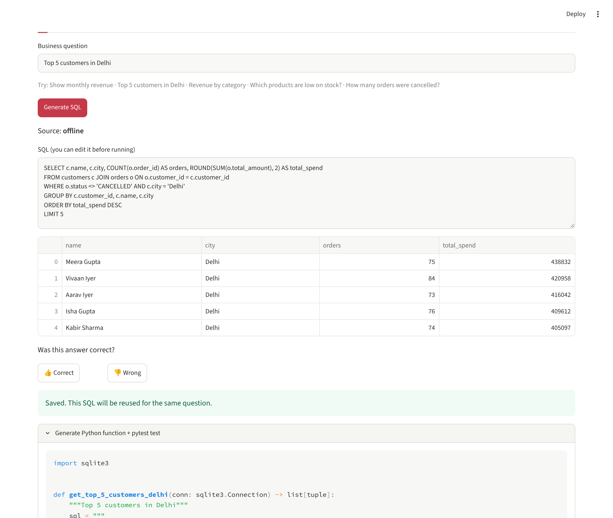
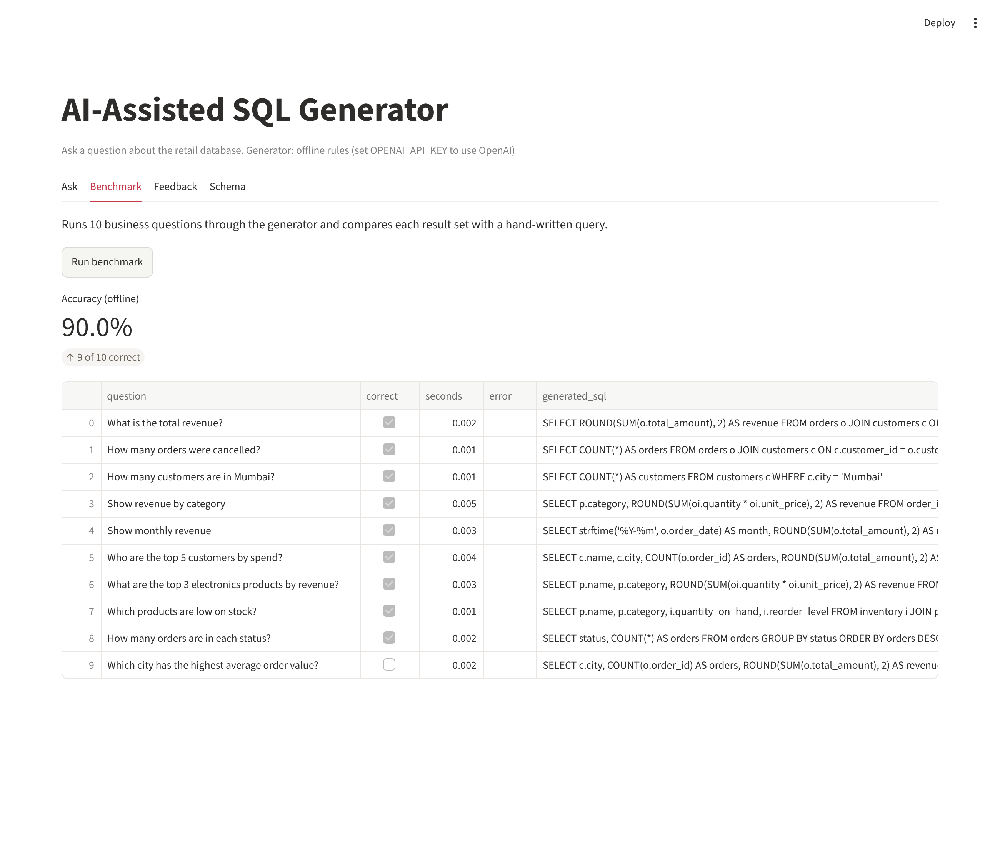

# AI-Assisted SQL Generation & Code-Completion Tool

A Copilot-style productivity tool for analysts: type a **business question in plain English**, get the **SQL**, the **results**, and ready-made **Python code + unit tests** for it. A built-in **benchmark** measures how often the generated SQL gives the same answer as hand-written SQL, and a **thumbs up / down feedback loop** makes it better over time.

1. **Ask**: "Top 5 customers in Delhi" → SQL → results table (and a chart when it fits).
2. **Generate**: SQL comes from the **OpenAI API** (schema-aware prompt), or from a simple **offline rule engine** when no API key is set, so the demo always works.
3. **Validate**: only a single read-only `SELECT` is allowed to run (no `DELETE`, `DROP`, ...).
4. **Feedback**: 👍 / 👎 are stored in a `query_feedback` table. Approved SQL is reused and fed back into the prompt as examples.
5. **Benchmark**: 10 business questions, generated vs hand-written SQL, compared on **result sets**.
6. **Code-completion**: turns an approved query into a Python function and a pytest test.

**Stack:** Python, OpenAI API, SQL (SQLite), pandas, Streamlit, pytest, GitHub Actions.



---

## How it works

```
 "Top 5 customers in Delhi"
          │
          ▼
 ┌────────────────────────── generator.py ──────────────────────────┐
 │ 1. Same question approved before?  ──yes──► reuse approved SQL   │
 │ 2. OPENAI_API_KEY set?             ──yes──► OpenAI API           │
 │       prompt = schema + business rules + approved examples       │
 │ 3. otherwise                       ───────► offline keyword rules│
 └──────────────────────────────────────────────────────────────────┘
          │ SQL
          ▼
  db.is_safe_select()  →  run on SQLite  →  results + chart
          │
          ├──► 👍 / 👎  → query_feedback table  (feedback loop, back to step 1 and 2)
          └──► codegen.py → Python function + pytest test
```

---

## The database (`data/schema.sql`)

The same retail model as my order-analytics project, created by `data/create_db.py` with a fixed random seed (40 customers, 20 products in 5 categories, 3,000 orders in 2026), so everyone gets the same data and the same benchmark score.

| Table | Key columns |
|-------|-------------|
| `customers` | customer_id, name, email, city, signup_date |
| `products` | product_id, sku, name, category, unit_price |
| `inventory` | product_id, quantity_on_hand, reorder_level |
| `orders` | order_id, customer_id, order_date, status (PLACED / SHIPPED / DELIVERED / CANCELLED), total_amount |
| `order_items` | order_item_id, order_id, product_id, quantity, unit_price |
| `query_feedback` | question, sql, rating (1 / -1), comment, source, created_at |

Want a bigger dataset? `python data/create_db.py --orders 100000`.

---

## SQL generation (`ai_sql/generator.py`)

**With an API key (OpenAI).** The prompt has three parts:
- **System message**: "write ONE SQLite SELECT", plus the business rules the model can't guess: cancelled orders are not revenue, product revenue = quantity × unit_price from `order_items`, months with `strftime('%Y-%m', ...)`.
- **Schema**: the `CREATE TABLE` statements, read live from the database, so the model only uses real tables and columns.
- **Few-shot examples**: the latest 5 questions users approved with 👍.

`temperature=0` so the same question gives the same SQL, and markdown fences (```sql) are stripped from the answer.

**Without a key (offline fallback, `ai_sql/offline.py`).** Keyword rules for the common questions (revenue, monthly trend, top customers / products, by category / city, average order value, counts, low stock, order status). It also picks up filters from the question: a city ("in Delhi"), a category ("electronics"), a status ("cancelled") and a number ("top 10"). If nothing matches, it says it didn't understand instead of guessing.

**Safety (`ai_sql/db.py`).** Generated SQL is never trusted. Before running, it must be a single statement that starts with `SELECT` or `WITH` and has no `INSERT / UPDATE / DELETE / DROP / ALTER / ...`.

---

## Benchmark: generated vs hand-written SQL (`ai_sql/benchmark.py`)

10 typical business questions, each with a hand-written reference query. For each question the tool generates SQL, runs both queries and checks if they return **the same result set** (rows sorted, numbers rounded to 2 decimals, column names ignored). Comparing results instead of SQL text is fair, because the same answer can be written many ways (JOIN ... ON vs USING, CTE vs subquery).

```bash
python -m ai_sql.benchmark
```

Offline rule engine result: **9 / 10 correct (90%)**. The miss is "Which city has the highest average order value?": the rules see "city" and return revenue by city, which is the wrong measure. That is exactly what the benchmark is for: it shows where a generator is wrong before users rely on it. With `OPENAI_API_KEY` set, the same command and the app's **Benchmark** tab score the OpenAI generator on the same questions. Feedback is switched off during the benchmark so approved answers can't inflate the score.



---

## Feedback loop (`ai_sql/feedback.py`)

| Step | What happens |
|------|-------------|
| User clicks 👍 | Question + SQL saved with rating 1. Next time the same question is asked (case and punctuation ignored), the approved SQL is returned instantly (source = `approved`) |
| User clicks 👎 | Saved with rating -1, never reused. The user can edit the SQL in the box and approve the corrected version |
| Next OpenAI call | The latest approved examples go into the prompt as few-shot examples |
| Feedback tab | 👍 / 👎 counts per source (openai, offline, approved), so you can see which generator needs work |

---

## Code-completion: function + unit test (`ai_sql/codegen.py`)

For any query you run, the app generates boilerplate you can paste into a project, for example:

```python
import sqlite3


def get_top_5_customers_delhi(conn: sqlite3.Connection) -> list[tuple]:
    """Top 5 customers in Delhi"""
    sql = """
        SELECT c.name, c.city, COUNT(o.order_id) AS orders, ROUND(SUM(o.total_amount), 2) AS total_spend
        ...
    """
    return conn.execute(sql).fetchall()
```

```python
def test_get_top_5_customers_delhi_runs(conn):
    assert isinstance(get_top_5_customers_delhi(conn), list)


def test_get_top_5_customers_delhi_shape(conn):
    rows = get_top_5_customers_delhi(conn)
    assert len(rows) == 5
    if rows:
        assert len(rows[0]) == 4
```

It is template-based, so the output is always valid Python. The test pins the row and column count seen when it was generated, so it works as a regression test. One of the project's own tests writes this generated code to disk and runs it with pytest to prove it passes.

---

## Code structure

```
app.py                Streamlit UI: Ask, Benchmark, Feedback, Schema tabs
ai_sql/db.py          Connect, read schema, safety check, run query
ai_sql/generator.py   Question -> SQL (approved -> OpenAI -> offline)
ai_sql/offline.py     Keyword-rule fallback generator
ai_sql/feedback.py    Save 👍/👎, reuse approved SQL, stats
ai_sql/benchmark.py   10 questions, generated vs hand-written, accuracy
ai_sql/codegen.py     Python function + pytest test from a query
data/schema.sql       Tables (retail model + query_feedback)
data/create_db.py     Builds data/retail.db with demo data
tests/                28 pytest tests
.github/workflows/    CI: build DB, run benchmark and tests on every push
```

---

## Run it locally (about 2 minutes)

```bash
python -m venv venv
venv\Scripts\activate            # Windows   (Mac/Linux: source venv/bin/activate)
pip install -r requirements.txt
python data/create_db.py         # creates data/retail.db
streamlit run app.py             # opens http://localhost:8501
```

Optional, to use OpenAI instead of the offline rules:
```bash
set OPENAI_API_KEY=sk-...        # Windows CMD   (PowerShell: $env:OPENAI_API_KEY="sk-..."; Mac/Linux: export OPENAI_API_KEY=sk-...)
streamlit run app.py
```
The key is only read from the environment, never stored in the code. Model defaults to `gpt-4o-mini` (change with `OPENAI_MODEL`).

### Quick demo
1. **Ask** tab: "Show monthly revenue" → SQL, results table and a bar chart. Then "Top 5 customers in Delhi".
2. Click **👍 Correct**, ask the same question again: source changes to **approved**.
3. Open **Generate Python function + pytest test**.
4. Ask "Which city has the highest average order value?": the offline answer is wrong. Click 👎, fix the SQL in the box:
   ```sql
   SELECT c.city, ROUND(AVG(o.total_amount), 2) AS avg_order_value
   FROM orders o JOIN customers c ON c.customer_id = o.customer_id
   WHERE o.status <> 'CANCELLED'
   GROUP BY c.city ORDER BY avg_order_value DESC LIMIT 1
   ```
   and click 👍. Ask again: the corrected SQL comes back.
5. **Benchmark** tab: Run benchmark → 90% with the reason for the miss.
6. Try "DELETE FROM orders" in the SQL box: blocked.

---

## Testing

```bash
pytest -v
```

28 tests, no API key or internet needed (OpenAI is replaced by a fake client in tests):

| File | What it checks |
|------|----------------|
| `tests/test_generator.py` | Offline rules + filters, unknown questions, safety check blocks DELETE / DROP / multiple statements, OpenAI prompt contains schema and approved examples, fence stripping, fallback without key |
| `tests/test_feedback.py` | Approved SQL is reused, 👎 is not, invalid ratings rejected, stats per source |
| `tests/test_benchmark.py` | Result comparison ignores row order and names, broken SQL is scored wrong (not a crash), all reference queries run, offline accuracy ≥ 8/10 |
| `tests/test_codegen.py` | Generated function names are valid; generated code + generated test actually pass under pytest |
